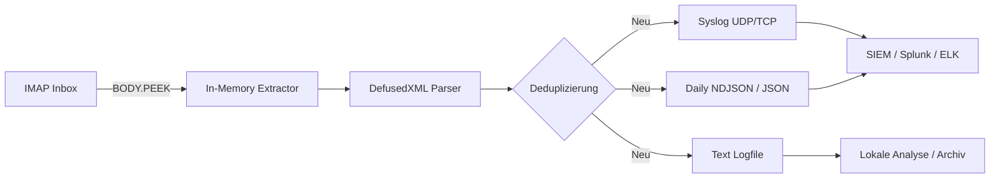
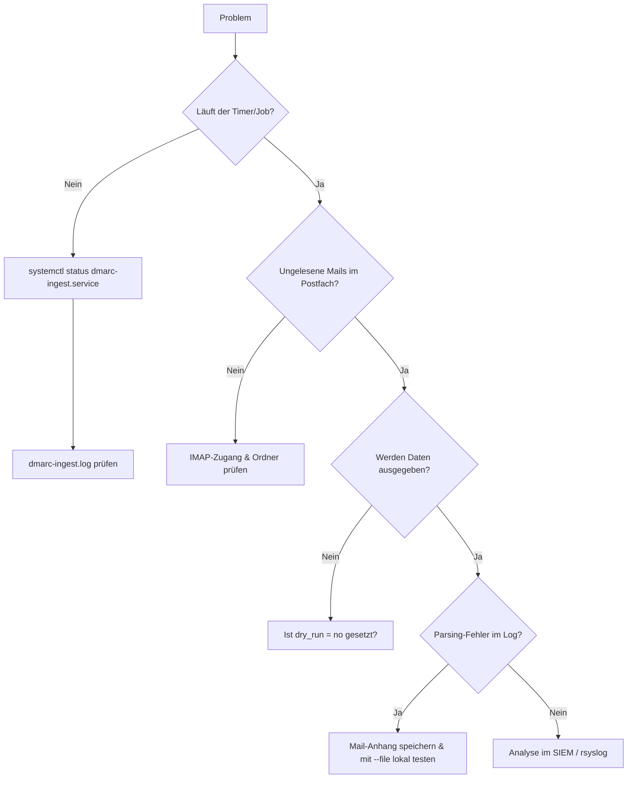

# dmarc-ingest

<p align="center">
  
</p>

<p align="center">
  
  
  
  
  
</p>


> **Projekt:** dmarc-ingest  
> **Beschreibung:** High-Performance DMARC RUA Ingest- und Normalisierungs-Engine (IMAP → Syslog / NDJSON / JSON / Textlog)  
> **Repository:** [https://github.com/hec1976/dmarc-ingest](https://github.com/hec1976/dmarc-ingest)

---

## Inhaltsverzeichnis

- [Überblick](#überblick)
- [Funktionsumfang](#funktionsumfang)
- [Architektur](#architektur)
- [Datenmodell](#datenmodell)
- [Voraussetzungen](#voraussetzungen)
- [Installation](#installation)
- [Konfiguration (`config.ini`)](#konfiguration-configini)
- [Betrieb](#betrieb)
- [Systemd-Integration](#systemd-integration)
- [Logverwaltung](#logverwaltung)
- [Syslog-Integration](#syslog-integration)
- [Datei- & Ordnerstruktur](#datei--ordnerstruktur)
- [Berechtigungen](#berechtigungen)
- [Beispiele](#beispiele)
- [Troubleshooting](#troubleshooting)
- [Sicherheit & Härtung](#sicherheit--härtung)
- [Leistung & Betriebshinweise](#leistung--betriebshinweise)
- [Roadmap / Ideen](#roadmap--ideen)
- [Lizenz](#lizenz)
- [Changelog](#changelog)
- [Contribution](#contribution)

---

## Überblick

`dmarc-ingest` ist ein robustes, log-basiertes Ingest-System für **DMARC-Aggregatberichte (RUA)**, ausgelegt für Hosting-Umgebungen mit hohem Mailaufkommen (1.000+ Domains).  
Es automatisiert den kompletten Weg von der E-Mail im IMAP-Postfach bis zu normalisierten Logdaten im SIEM (Splunk, ELK, Graylog):

- Abruf von DMARC-Reports per IMAP (IMAPS) via `BODY.PEEK[]` (kein Datenverlust bei Verbindungsabbruch)
- In-Memory-Entpacken von komprimierten Anhängen (`.zip`, `.gz`, `.tar.gz`, `.tgz`)
- Gehärtetes Parsing der DMARC-XML-Struktur (`defusedxml` + Größenlimits gegen Decompression Bombs)
- Normalisierung in ein einheitliches, flaches Record-Schema
- Paralleler Export nach **Syslog (UDP/TCP)**, **NDJSON / JSON** und **Text-Log**
- Schnelle RAM-basierte Deduplizierung bereits verarbeiteter Reports (Tracking nach Ingest-Zeitpunkt, sodass auch verspätet nachgelieferte Alt-Reports zuverlässig erkannt werden)
- Lockfile-Mechanismus (`fcntl`), damit nie zwei Jobs gleichzeitig laufen
- Getrennte, automatische Aufräumlogik für alte JSON-Tagesdateien und den Deduplizierungs-Cache
- Isoliertes **Python Virtual Environment (venv)** zum Schutz des Host-Systems

Ziel ist ein **einfach zu betreibendes, aber hochgradig betriebssicheres** Tool für Mail- und Security-Teams.

---

## Funktionsumfang

### Core
- IMAP-Fetch über SSL/TLS (`IMAP4_SSL`)
- Konfigurierbarer Quellordner (`INBOX`) und automatischer Archivordner (`INBOX/Processed`)
- Lokaler Dateimodus (`--file`) für manuelle Analysen und Tests

### Datei- & Formatunterstützung
- Unterstützte Anhänge: `.xml`, `.gz`, `.zip`, `.tgz`, `.tar.gz`
- Mehrere Archive pro Mail sowie mehrere XML-Dateien pro Archiv werden einzeln erkannt und dedupliziert
- Sicheres XML-Parsing über `defusedxml` (mit automatischem Fallback)
- Integrierter Schutz gegen ZIP-/GZIP-Bomben (max. 50 MB pro XML im RAM)

### Ausgabe
- Strukturierte Key-Value-Ausgabe über Syslog (UDP und TCP inkl. Newline-Framing)
- Pro Tag eine JSON-Sammeldatei (`YYYYMMDD_all.json`)
- Wahlweise **NDJSON** (empfohlen für Streaming/SIEM) oder **Array-JSON**
- Optionales strukturiertes Text-Log (`dmarc_data.log`)

### Betrieb & Stabilität
- **Dry-Run-Modus** (`dry_run = yes`: liest Mails via `BODY.PEEK[]`, verändert weder Postfach noch Dateien)
- **Lockfile** (`/run/lock/dmarc-ingest.lock`) verhindert überlappende Cron-/Timer-Läufe
- **Atomare Schreibvorgänge** für den Cache (`processed.json.tmp` → `os.replace`) verhindern korrupte Dateien bei Stromausfall
- Separate Aufbewahrungsfristen für Report-Dateien (`days_to_keep`) und den Duplikat-Cache (`processed_days_to_keep`)

---

## Architektur



**Logger-Klassen:**
- `DMARC_SCRIPT` – Steuerungs-, Ablauf- und Fehlermeldungen des Collectors
- `DMARC_DATA` – Reine Nutzdaten (normalisierte DMARC-Records) für die Syslog-Weiterleitung

### Architekturentscheidung: NDJSON & Logs statt Datenbank

DMARC-Reports sind klassische **Zeitreihen- und Logdaten**:
- Hohe Schreibfrequenz, keinerlei nachträgliche Updates (`Append-Only`)
- Vorrangig zeitbasierte Auswertungen („letzte X Tage“)
- Schnelles Datenwachstum bei vielen Domains

Statt einer wartungsintensiven SQL-Datenbank setzt `dmarc-ingest` auf flache Streams (Syslog & NDJSON), die ohne Zwischenspeicher direkt von bestehenden Log-Pipelines (Splunk Universal Forwarder, Filebeat, Vector, rsyslog) aufgenommen werden können.

---

## Datenmodell

### Beispiel eines normalisierten DMARC-Records (JSON / NDJSON)

```json
{
  "org": "google.com",
  "report_id": "1234567890123456789",
  "domain": "example.com",
  "policy": "reject",
  "begin": "1720569600",
  "end": "1720656000",
  "ip": "203.0.113.45",
  "count": "17",
  "disposition": "reject",
  "dkim": "pass",
  "spf": "pass",
  "header_from": "example.com",
  "dkim_domain": "example.com",
  "dkim_result": "pass",
  "spf_domain": "example.com",
  "spf_result": "pass"
}
```

---

## Voraussetzungen

- **Python:** 3.6 oder neuer (getestet bis 3.12)
- **OS:** Linux (Debian/Ubuntu, RHEL/Alma/Rocky, SUSE)
- **Umgebung:** `python3-venv` Paket (bei Debian/Ubuntu oft getrennt zu installieren: `apt install python3-venv`)
- Alle weiteren Module (`imaplib`, `email`, `gzip`, `zipfile`, `tarfile`, `fcntl`, `logging`) sind Teil der Python-Standardbibliothek. Das Modul `defusedxml` wird im Rahmen der Installation automatisch im Venv geladen.

---

## Installation

### 1. Verzeichnisse anlegen

```bash
sudo mkdir -p /opt/dmarc-ingest
sudo mkdir -p /var/lib/dmarc-ingest/reports
sudo mkdir -p /var/log/dmarc-ingest
```

### 2. Systembenutzer & Berechtigungen einrichten

```bash
sudo groupadd -r dmarc-ingest
sudo useradd -r -s /usr/sbin/nologin -g dmarc-ingest -d /var/lib/dmarc-ingest dmarc-ingest
```

### 3. Dateien deployen

Kopiere die Dateien aus dem Repository in das Zielverzeichnis:

```bash
# Programmdateien kopieren
sudo cp dmarc-ingest.py setup-venv.sh requirements.txt /opt/dmarc-ingest/
sudo chmod +x /opt/dmarc-ingest/dmarc-ingest.py
sudo chmod +x /opt/dmarc-ingest/setup-venv.sh

# Konfiguration anlegen (Rechte werden in Schritt 5 gesetzt)
sudo cp config.ini /opt/dmarc-ingest/config.ini
```

### 4. Virtuelle Umgebung (venv) einrichten

Um das System vor Konflikten zu schützen, wird das Programm in einer virtuellen Umgebung ausgeführt.

```bash
# Setup als dmarc-ingest Nutzer ausführen
sudo -u dmarc-ingest /opt/dmarc-ingest/setup-venv.sh
```

### 5. Finale Rechtevergabe

```bash
sudo chown -R dmarc-ingest:dmarc-ingest \
  /opt/dmarc-ingest \
  /var/lib/dmarc-ingest \
  /var/log/dmarc-ingest

sudo chmod 0750 /opt/dmarc-ingest
sudo chmod 0600 /opt/dmarc-ingest/config.ini
sudo chmod 0750 /var/lib/dmarc-ingest /var/log/dmarc-ingest
```

---

## Konfiguration (`config.ini`)

```ini
; ======================================================================
; dmarc-ingest - config.ini
; Wichtig: Dateirechte auf 0600 setzen (chmod 600 config.ini)
; ======================================================================

[imap]
host = imap.example.com
user = dmarc-reports@example.com
; Hinweis: Falls das Passwort ein %-Zeichen enthält, als %% schreiben!
password = ***CHANGE_ME***
folder = INBOX
; Je nach Mailserver INBOX/Processed oder INBOX.Processed
archive_folder = INBOX/Processed


[syslog]
enable = yes
host = 127.0.0.1
port = 514
; udp oder tcp
protocol = udp


[options]
save_json = yes
xml_output_dir = /var/lib/dmarc-ingest/reports

; Aufbewahrungsdauer für die JSON-Tagesdateien in xml_output_dir (in Tagen)
days_to_keep = 30

; CACHE: Wie lange merken wir uns bereits verarbeitete Report-IDs? (in Tagen)
processed_days_to_keep = 3

; Testmodus (yes = keine Änderungen am IMAP-Postfach, keine Datei-/Syslog-Ausgabe)
dry_run = no

; Einzelne Records an Syslog / Text-Log ausgeben
log_records = yes

write_text_log = yes
text_log_path = /var/log/dmarc-ingest/dmarc_data.log

; 'ndjson' (empfohlen für hohe Performance & SIEM) oder 'array'
json_mode = ndjson

; Datenbank für bereits verarbeitete Report-IDs (Duplikat-Schutz)
processed_db = /var/lib/dmarc-ingest/processed.json

; Lockfile verhindert parallele Ausführung bei überlappenden Läufen
lock_file = /run/lock/dmarc-ingest.lock


[logging]
; Bei Hintergrund-/Cron-Betrieb auf 'no' setzen, wenn File-Logging aktiv ist
console = yes
enable_file = yes
file_path = /var/log/dmarc-ingest/dmarc-ingest.log
```

---

## Betrieb

### Manueller Lauf (IMAP-Abruf)

Führe das Script stets über das konfigurierte Virtual Environment (`venv`) aus:

```bash
sudo -u dmarc-ingest /opt/dmarc-ingest/venv/bin/python3 /opt/dmarc-ingest/dmarc-ingest.py --loglevel=INFO
```

### Verarbeitung einer lokalen Testdatei (`--file`)

Für Debugging oder das nachträgliche Einlesen einzelner Archive (`.xml`, `.zip`, `.gz`, `.tgz`, `.tar.gz`):

```bash
sudo -u dmarc-ingest /opt/dmarc-ingest/venv/bin/python3 /opt/dmarc-ingest/dmarc-ingest.py --loglevel=DEBUG --file ./sample_report.zip
```

---

## Systemd-Integration

Da `dmarc-ingest` alle ungelesenen Mails in einem Durchlauf abarbeitet und sich danach sauber beendet, erfolgt der Betrieb über eine `oneshot`-Service-Unit in Kombination mit einem Systemd-Timer.

### 1. Service-Unit (`/etc/systemd/system/dmarc-ingest.service`)

```ini
[Unit]
Description=dmarc-ingest – DMARC RUA Collector (IMAP -> Syslog/JSON)
After=network-online.target
Wants=network-online.target

[Service]
Type=oneshot
User=dmarc-ingest
Group=dmarc-ingest
WorkingDirectory=/opt/dmarc-ingest
# Aufruf über das Virtual Environment (venv)
ExecStart=/opt/dmarc-ingest/venv/bin/python3 /opt/dmarc-ingest/dmarc-ingest.py --loglevel=INFO

# Systemd-Härtung (Sandboxing)
NoNewPrivileges=yes
ProtectSystem=strict
ProtectHome=true
PrivateTmp=true
PrivateDevices=true
ProtectClock=true
ProtectKernelTunables=yes
ProtectKernelModules=yes
ProtectKernelLogs=yes
LockPersonality=yes
MemoryDenyWriteExecute=yes
RestrictRealtime=yes
RestrictSUIDSGID=yes
RestrictAddressFamilies=AF_UNIX AF_INET AF_INET6
CapabilityBoundingSet=
UMask=0027

# Explizite Schreibrechte trotz ProtectSystem=strict
ReadWritePaths=/var/lib/dmarc-ingest /var/log/dmarc-ingest /run/lock
```

### 2. Timer-Unit (`/etc/systemd/system/dmarc-ingest.timer`)

```ini
[Unit]
Description=Run dmarc-ingest every 10 minutes

[Timer]
OnBootSec=2m
OnUnitActiveSec=10m
Persistent=true
Unit=dmarc-ingest.service

[Install]
WantedBy=timers.target
```

### 3. Timer aktivieren

```bash
sudo systemctl daemon-reload
sudo systemctl enable --now dmarc-ingest.timer

# Status und nächsten Lauf prüfen:
systemctl list-timers dmarc-ingest.timer
```

---

## Logverwaltung

Die JSON-Tagesdateien in `xml_output_dir` sowie die `processed.json` bereinigt das Script selbstständig. Für die Text-Logs unter `/var/log/dmarc-ingest/` empfiehlt sich `logrotate`.

### `/etc/logrotate.d/dmarc-ingest`

```conf
/var/log/dmarc-ingest/*.log {
    daily
    rotate 30
    compress
    delaycompress
    missingok
    notifempty
    create 0640 dmarc-ingest dmarc-ingest
}
```

---

## Syslog-Integration

Das Script sendet DMARC-Records mit dem Präfix `DMARC: org=...`.

### rsyslog (`/etc/rsyslog.d/10-dmarc-ingest.conf`)

```conf
# Optional: Lokalen UDP/TCP-Empfang aktivieren (falls nicht bereits global aktiv)
module(load="imudp")
input(type="imudp" port="514")

# DMARC-Records in eigene Datei leiten
if $msg contains 'DMARC: org=' then {
    action(
        type="omfile"
        file="/var/log/dmarc-ingest/dmarc_syslog.log"
    )
    stop
}
```

---

## Datei- & Ordnerstruktur

```text
/opt/dmarc-ingest/
  ├── venv/                    # Isolierte Python-Umgebung (generiert)
  ├── requirements.txt         # Abhängigkeiten
  ├── setup-venv.sh            # Setup-Script
  ├── dmarc-ingest.py          # Hauptskript
  └── config.ini               # Konfiguration (Modus 0600)

/var/lib/dmarc-ingest/
  ├── reports/                 # Tagesarchive (NDJSON / JSON)
  │   ├── 20261016_all.json
  │   └── 20261017_all.json
  └── processed.json           # Schneller Deduplizierungs-Cache

/var/log/dmarc-ingest/
  ├── dmarc-ingest.log         # Applikations- und Fehler-Log
  └── dmarc_data.log           # Optionales Pipe-getrenntes Record-Log

/run/lock/
  └── dmarc-ingest.lock        # Lockfile mit PID während der Laufzeit
```

---

## Berechtigungen

| Pfad | Besitzer | Modus | Zweck |
| :--- | :--- | :--- | :--- |
| `/opt/dmarc-ingest` | `dmarc-ingest:dmarc-ingest` | `0750` | Programmverzeichnis |
| `/opt/dmarc-ingest/config.ini` | `dmarc-ingest:dmarc-ingest` | `0600` | Konfiguration & IMAP-Passwort |
| `/var/lib/dmarc-ingest` | `dmarc-ingest:dmarc-ingest` | `0750` | Laufzeitdaten, Cache & JSON-Reports |
| `/var/log/dmarc-ingest` | `dmarc-ingest:dmarc-ingest` | `0750` | Logdateien |
| `/run/lock/dmarc-ingest.lock` | `dmarc-ingest:dmarc-ingest` | `0644` | Lockfile (wird automatisch angelegt) |

---

## Beispiele

### 1. Ausgabe im Syslog (`DMARC_DATA`)

```text
DMARC: org=google.com report_id=1234567890 domain=example.com policy=reject ip=203.0.113.45 count=17 disposition=reject dkim=pass spf=pass header_from=example.com begin=1720569600 end=1720656000 dkim_domain=example.com dkim_result=pass spf_domain=example.com spf_result=pass
```

### 2. Ausgabe im Text-Log (`dmarc_data.log`)

```text
2026-10-17T14:22:10.123456 | org=google.com | report_id=1234567890 | domain=example.com | policy=reject | ip=203.0.113.45 | count=17 | disposition=reject | dkim=pass | spf=pass | header_from=example.com | dkim_domain=example.com | dkim_result=pass | spf_domain=example.com | spf_result=pass
```

---

## Troubleshooting



### Häufige Ursachen

- **IMAP-Fehler `Konnte IMAP Ordner 'INBOX/Processed' nicht anlegen`:**
  Einige Mailserver (z. B. Courier/Cyrus) nutzen einen Punkt statt eines Schrägstrichs als Trennzeichen. In der `config.ini` auf `INBOX.Processed` ändern.
- **Passwort-Fehler bei Sonderzeichen (`InterpolationSyntaxError`):**
  Enthält das IMAP-Passwort ein `%`-Zeichen, muss es in der `config.ini` verdoppelt werden (`%%`).
- **Keine Schreibvorgänge trotz gefundener Mails:**
  Prüfen, ob in der `config.ini` noch `dry_run = yes` aktiviert ist.
- **Modul `defusedxml` fehlt:**
  Sicherstellen, dass `setup-venv.sh` fehlerfrei durchgelaufen ist und der Dienst über `/opt/dmarc-ingest/venv/bin/python3` aufgerufen wird.

---

## Sicherheit & Härtung

- **Isolierte Python-Umgebung:** Das Setup läuft gekapselt in einem `venv` und kann bestehende System-Pakete nicht beeinträchtigen.
- **Schutz vor XML-Bomben:** Durch den Einsatz von `defusedxml` werden XML-Angriffe wie *Billion Laughs* oder *External Entity Expansion (XXE)* blockiert.
- **Schutz vor Decompression Bombs:** Beim Entpacken von `.gz`-, `.zip`- und `.tar.gz`-Archiven im Arbeitsspeicher greift ein hartes Limit von 50 MB (`MAX_XML_SIZE`), um Out-of-Memory-Abstürze durch manipulierte Archive zu verhindern.
- **Transaktionssicherheit im Postfach:** Mails werden mit `BODY.PEEK[]` abgerufen. Das `\Seen`-Flag oder das Verschieben ins Archiv erfolgt erst, wenn das Parsing und Log-Schreiben fehlerfrei abgeschlossen sind.

---

## Leistung & Betriebshinweise

- **Hohe Volumina (1.000+ Domains):** Unbedingt `json_mode = ndjson` verwenden. Dadurch werden neue Datensätze per Datei-Append geschrieben, ohne die bestehende Tagesdatei in den RAM laden zu müssen.
- **Kleiner Deduplizierungs-Cache:** Über `processed_days_to_keep = 3` bleibt die `processed.json` dauerhaft schlank, während die eigentlichen JSON-Tagesreports über `days_to_keep = 30` unabhängig davon länger archiviert werden können.
- **Dedup nach Ingest-Zeitpunkt:** Der Cache merkt sich, *wann* ein Report eingeliefert wurde – nicht, wie alt der Report ist. Verspätet nachgelieferte Reports werden daher während der gesamten konfigurierten Cache-Dauer sicher als Duplikat erkannt. Liefern Provider bei dir regelmäßig Reports später als das Cache-Fenster nach, den Wert einfach erhöhen (z. B. 7–14 Tage).

---

## Roadmap / Ideen

- [ ] Optionale Unterstützung für mehrere DKIM-Signaturen pro Record-Block
- [ ] Prometheus-Metrik-Export (Textfile-Collector für Node-Exporter)
- [ ] Direkter Webhook-/HTTP-Output für Elasticsearch / Splunk HEC

---

## Lizenz

Dieses Projekt steht unter der **MIT License** (`SPDX-License-Identifier: MIT`).  
Weitere Details siehe `LICENSE`-Datei im Repository.

---

## Changelog

### [1.3.0] – 2026-10-17

**Fixed**
- Deduplizierungs-Cache trackt jetzt die **Ingest-Zeit** pro Report statt das Report-`end`-Datum mit dem Cache-Fenster zu vergleichen. Verspätet nachgelieferte Reports werden dadurch nicht mehr vorzeitig aus dem Cache entfernt und erneut verarbeitet (keine Duplikate mehr im SIEM)
- `move_message` prüft nun das Ergebnis des `\Deleted`-Flags und loggt eine Warnung, falls eine Mail nach dem Kopieren nicht als gelöscht markiert werden konnte

**Added**
- Automatische Migration der `processed.json` beim Upgrade von v1.2.x (Listen-Format) auf das neue Dict-Format (Key → Ingest-Timestamp). Bestehende Installationen verlieren ihren Dedup-Status nicht

**Improved**
- Neue Standard-Pfade konsistent zum Setup (`/var/lib/dmarc-ingest`, `/var/log/dmarc-ingest`, `/run/lock/dmarc-ingest.lock`)
- Cache-Standard auf `processed_days_to_keep = 3`, JSON-Aufbewahrung auf `days_to_keep = 30`

### [1.2.2] – 2026-10-17

**Added**
- Python Virtual Environment (venv) Support integriert
- Schutz gegen Decompression-Bomben (`MAX_XML_SIZE` = 50 MB Limit für GZIP/ZIP/TAR)
- Zentrale `emit_records()`-Ausgabesteuerung
- Explizite Sicherheitswarnung im Log, falls `defusedxml` auf dem System fehlt

**Improved**
- IMAP-Abruf nutzt nun `BODY.PEEK[]` statt `RFC822` (verhindert Datenverlust bei Abbruch und lässt das Postfach im `dry_run`-Modus unberührt)
- Deduplizierung erfolgt nun granular pro einzelnem XML-Report statt pauschal pro E-Mail
- Atomares Schreiben (`os.replace`) auch für JSON-Tagesdateien im Array-Modus

**Fixed**
- TCP-Syslog-Framing repariert (`terminator = "\n"` ergänzt)
- `write_text_log` funktioniert nun auch unabhängig davon, ob `syslog` aktiviert ist
- Fehlertolerante UTF-8-Dekodierung (`errors="replace"`) bei defekten Zeichen in Provider-Reports

### [1.2.1] – 2025-12-20

**Added**
- Erweitertes Text-Log mit vollständigen DMARC-Feldern
- Verbessertes Error-Handling bei ZIP/TAR/XML
- PID-Schreibung im Lockfile

**Improved**
- Dedupe-Performance optimiert (`processed_days_to_keep`)
- Purge nur noch beim Speichern → kleiner & schneller Cache
- Stabileres IMAP-Folder-Handling & NDJSON-Writer

**Fixed**
- Doppelte Syslog-Einträge entfernt
- Korrigierte JSON-Schreibfehler bei fehlenden Unterordnern
- Robustere MIME-Header-Dekodierung

### [1.2.0] – 2025-12-05

**Added**
- NDJSON-Unterstützung (`json_mode = ndjson`)
- Lockfile-Mechanismus (`lock_file`) zum Schutz vor Parallel-Jobs
- Automatische Bereinigung alter `processed_db`-Einträge

### [1.1.0] – 2025-10-15

**Added**
- Deduplizierung von Reports über `processed_db`
- Konfigurierbare Aufbewahrungsfristen (`days_to_keep`)

### [1.0.0] – 2025-09-10

- Initial Release (IMAP-Abruf, Syslog-Export, JSON-Tagesarchive)

---

## Contribution

Beiträge sind jederzeit willkommen!
- Issues & Feature-Requests bitte direkt im GitHub-Repository eröffnen.
- Pull Requests gerne mit kurzer Beschreibung und aktualisierter Dokumentation einreichen.
