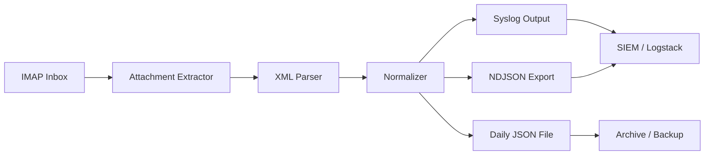
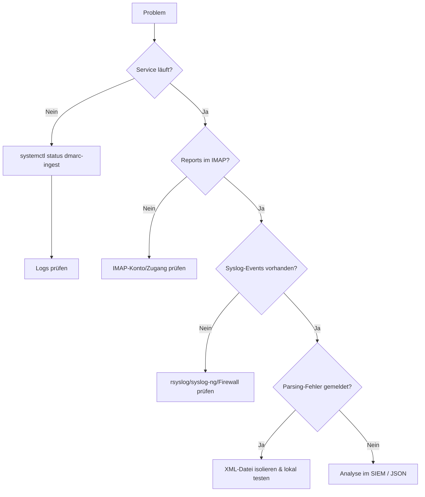

# dmarc-ingest 

```
██████╗ ███╗   ███╗ █████╗ ██████╗  ██████╗     ██╗███╗   ██╗ ██████╗ ███████╗███████╗████████╗
██╔══██╗████╗ ████║██╔══██╗██╔══██╗██╔════╝     ██║████╗  ██║██╔════╝ ██╔════╝██╔════╝╚══██╔══╝
██║  ██║██╔████╔██║███████║██████╔╝██║  ███╗    ██║██╔██╗ ██║██║  ███╗█████╗  ███████╗   ██║
██║  ██║██║╚██╔╝██║██╔══██║██╔══██╗██║   ██║    ██║██║╚██╗██║██║   ██║██╔══╝  ╚════██║   ██║
██████╔╝██║ ╚═╝ ██║██║  ██║██║  ██║╚██████╔╝    ██║██║ ╚████║╚██████╔╝███████╗███████║   ██║
╚═════╝ ╚═╝     ╚═╝╚═╝  ╚═╝╚═╝  ╚═╝ ╚═════╝     ╚═╝╚═╝  ╚═══╝ ╚═════╝ ╚══════╝╚══════╝   ╚═╝
```


> **Projekt:** dmarc-ingest  
> **Beschreibung:** DMARC RUA Ingest- und Normalisierungs-Engine (IMAP → Syslog/JSON/NDJSON)  
> **Repository:** https://github.com/hec1976/dmarc-ingest  


---

## Inhaltsverzeichnis

- [Überblick](#-überblick)
- [Funktionsumfang](#-funktionsumfang)
- [Architektur](#-architektur)
- [Datenmodell](#-datenmodell)
- [Voraussetzungen](#-voraussetzungen)
- [Installation](#-installation)
- [Konfiguration](#-konfiguration-configini)
- [Betrieb](#-betrieb)
- [Systemd-Integration](#-systemd-integration)
- [Logverwaltung](#-logverwaltung)
- [Syslog-Integration](#-syslog-integration)
- [Datei- & Ordnerstruktur](#-datei--ordnerstruktur)
- [Berechtigungen](#-berechtigungen)
- [Beispiele](#-beispiele)
- [Troubleshooting](#-troubleshooting)
- [Sicherheit & Härtung](#-sicherheit--härtung)
- [Leistung & Betriebshinweise](#-leistung--betriebshinweise)
- [Roadmap / Ideen](#-roadmap--ideen)
- [Lizenz](#-lizenz)
- [Changelog](#-changelog)
- [Contribution](#-contribution)

---

## Überblick

`dmarc-ingest` ist ein robustes, log-basiertes Ingest-System für **DMARC-Aggregatberichte (RUA)**.  
Es automatisiert den kompletten Weg von der E-Mail im IMAP-Postfach bis zu normalisierten Logdaten im SIEM:

- Abruf von DMARC-Reports per IMAP (IMAPS)
- Entpacken von komprimierten Anhängen (ZIP/GZ/TAR.GZ/TGZ)
- Parsing der DMARC-XML-Struktur (fehler- und vendor-tolerant)
- Normalisierung in ein einheitliches Record-Schema
- Export nach **Syslog**, **JSON** und **NDJSON**
- Deduplizierung bereits verarbeiteter Reports
- Lockfile-Mechanismus, damit nie zwei Jobs gleichzeitig laufen
- Automatische Aufräumlogik für alte JSON-Dateien und processed-DB

Ziel ist ein **einfach zu betreibendes, aber betriebssicheres** Tool für Mail- und Security-Teams.

---

## Funktionsumfang

### Core

- IMAP-Fetch mit SSL/TLS
- konfigurierbarer Quellordner und Archivordner
- Verarbeitung lokaler Dateien (`--file`) für Tests

### Datei- & Formatunterstützung

- Anhänge: `.xml`, `.gz`, `.zip`, `.tgz`, `.tar.gz`
- Mehrere XML-Dateien pro E-Mail werden erkannt und verarbeitet
- XML-Parsing über `defusedxml` (Fallback möglich)

### Ausgabe

- strukturierte Ausgabe über Syslog (UDP/TCP, RFC-5424-kompatibel)
- pro Tag eine JSON-Sammeldatei (`YYYYMMDD_all.json`)
- wahlweise **Array-JSON** oder **NDJSON** (eine JSON-Zeile pro Record)
- optionales Text-Log pro Record

### Betrieb & Stabilität

- **Dry-Run-Modus** (keine Schreiboperationen, ideal für erste Tests)
- **Lockfile** (`/run/lock/dmarc-ingest.lock`) verhindert parallele Ausführung
- **processed_db** verhindert doppelte Verarbeitung identischer Reports
- automatische Bereinigung alter JSON- und processed_db-Einträge basierend auf `days_to_keep`
- klare Exitcodes und Logging

---

##  Architektur



**Logger-Klassen:**

- `DMARC_SCRIPT` – Steuerungs-, Ablauf- und Fehlermeldungen
- `DMARC_DATA` – strukturierte DMARC-Records für Weiterleitung/Indexierung

### Architekturentscheidung: JSON & Logs statt Datenbank

DMARC-Reports sind typische **Logdaten**:

- hohe Schreibfrequenz, praktisch keine Updates
- vorrangig zeitbasierte Abfragen („letzte x Tage“)
- Datenmengen wachsen schnell

Eine relationale Datenbank wäre:

- komplexer im Betrieb (Backup, Indexpflege, Tuning)
- anfälliger für Performance-Probleme bei großen Tabellen
- ein zusätzlicher Single Point of Failure

`dmarc-ingest` setzt daher auf:

- Append-Only-Logs (JSON/NDJSON)
- Integration in bestehende Log-Pipelines (Syslog, ELK, Graylog, Splunk)
- optional nachgelagerte Aggregation/Reporting in dedizierten BI/Reporting-Systemen

---

## Datenmodell

### Beispiel eines normalisierten DMARC-Records (NDJSON)

```json
{
  "org": "Google",
  "report_id": "1234567890",
  "domain": "example.com",
  "policy": "reject",
  "source_ip": "203.0.113.45",
  "count": 17,
  "disposition": "reject",
  "dkim": "pass",
  "spf": "pass",
  "header_from": "example.com",
  "begin": "2024-10-01T00:00:00Z",
  "end": "2024-10-01T23:59:59Z",
  "dkim_domain": "example.com",
  "dkim_result": "pass",
  "spf_domain": "_spf.example.com",
  "spf_result": "pass",
  "ingest_timestamp": "2024-12-05T10:30:15Z"
}
```

Eigenschaften:

- Zeitangaben als ISO-8601-Strings
- Felder, die im Report fehlen, werden leer oder `null` gesetzt
- alle Records folgen dem gleichen Schema, unabhängig vom Provider

---

## Voraussetzungen

- **Python**: 3.6 oder neuer (getestet mit 3.8+)
- **OS**: Linux (Debian/Ubuntu, RHEL/CentOS, SUSE etc.)
- Python-Module:
  - `defusedxml` (empfohlen, für sicheres XML-Parsing)
  - `imaplib2` oder Standard-IMAP-Library (abhängig von der Implementation)
  - Standard-Libs: `logging`, `json`, `gzip`, `zipfile`, `tarfile`, `argparse`, `pathlib`, ...

---

## Installation

### Verzeichnisse anlegen

```bash
sudo mkdir -p /opt/dmarc-ingest
sudo mkdir -p /var/lib/dmarc-ingest/reports
sudo mkdir -p /var/log/dmarc-ingest
sudo mkdir -p /etc/dmarc-ingest
```

### Dateien deployen

```bash
sudo cp dmarc-ingest.py /opt/dmarc-ingest/
sudo cp config.ini.example /etc/dmarc-ingest/config.ini
sudo ln -sf /etc/dmarc-ingest/config.ini /opt/dmarc-ingest/config.ini
```

### Systembenutzer anlegen

```bash
sudo groupadd dmarc-ingest
sudo useradd -r -s /bin/false -g dmarc-ingest dmarc-ingest
```

### Rechte setzen

```bash
sudo chown -R dmarc-ingest:dmarc-ingest   /opt/dmarc-ingest   /var/lib/dmarc-ingest   /var/log/dmarc-ingest   /etc/dmarc-ingest

sudo chmod 0750 /etc/dmarc-ingest
sudo chmod 0640 /etc/dmarc-ingest/config.ini
sudo chmod -R 0750 /opt/dmarc-ingest
sudo chmod -R 0770 /var/lib/dmarc-ingest /var/log/dmarc-ingest
```

---

## Konfiguration (`config.ini`)

Beispielkonfiguration:

```ini
[imap]
host = imap.example.com
port = 993
user = dmarc-reports@example.com
password = ***CHANGE_ME***
folder = INBOX
archive_folder = INBOX/Processed
ssl = yes

[syslog]
enable = yes
host = 127.0.0.1
port = 514
protocol = udp      ; udp oder tcp
facility = local0
tag = DMARC_DATA

[output]
save_json = yes
xml_output_dir = /var/lib/dmarc-ingest/reports
json_mode = ndjson          ; array oder ndjson
text_log_enable = yes
text_log_path = /var/log/dmarc-ingest/dmarc_data.log

[retention]
days_to_keep = 30

[processing]
dry_run = no
max_emails_per_run = 50
processed_db = /var/lib/dmarc-ingest/processed.json
lock_file = /run/lock/dmarc-ingest.lock
timeout = 300

[logging]
level = INFO
file = /var/log/dmarc-ingest/dmarc-ingest.log
max_size_mb = 10
backup_count = 5
```

### Hinweise

- `archive_folder`: je nach IMAP-Server ggf. `INBOX.Processed` statt `INBOX/Processed`.
- `dry_run = yes`: ideal, um Konfiguration zu testen, ohne E-Mails zu verschieben oder Logs zu schreiben.
- `json_mode = ndjson`: empfohlen bei großen Datenmengen → speicherschonend, besser für Stream-Verarbeitung.
- `processed_db`: verhindert doppelte Verarbeitung; Einträge älter als `days_to_keep` werden gelöscht.
- `lock_file`: verhindert parallele Läufe; bei Crash Lockfile prüfen.

---

## Betrieb

### Einmaliger Testlauf (IMAP)

```bash
sudo -u dmarc-ingest python3 /opt/dmarc-ingest/dmarc-ingest.py --loglevel=INFO --dry-run
```

### Regulärer Aufruf (IMAP)

```bash
sudo -u dmarc-ingest python3 /opt/dmarc-ingest/dmarc-ingest.py --loglevel=INFO
```

### Verarbeitung einer lokalen Testdatei

```bash
sudo -u dmarc-ingest python3 /opt/dmarc-ingest/dmarc-ingest.py --loglevel=DEBUG --file ./sample_report.zip
```

---

## Systemd-Integration

### Service-Unit `/etc/systemd/system/dmarc-ingest.service`

```ini
[Unit]
Description=dmarc-ingest – DMARC RUA Collector (IMAP -> Syslog/JSON)
After=network-online.target
Wants=network-online.target

[Service]
Type=simple
User=dmarc-ingest
Group=dmarc-ingest
WorkingDirectory=/opt/dmarc-ingest
ExecStart=/usr/bin/python3 /opt/dmarc-ingest/dmarc-ingest.py --loglevel=INFO
Restart=on-failure
RestartSec=5s

# Systemd-Härtung
NoNewPrivileges=yes
ProtectSystem=strict
ProtectHome=true
PrivateTmp=true
PrivateDevices=true
ProtectClock=true
ProtectKernelTunables=yes
ProtectKernelModules=yes
ProtectKernelLogs=yes
LockPersonality=yes
MemoryDenyWriteExecute=yes
RestrictRealtime=yes
RestrictSUIDSGID=yes
RestrictAddressFamilies=AF_UNIX AF_INET AF_INET6
CapabilityBoundingSet=
UMask=007

[Install]
WantedBy=multi-user.target
```

### Timer-Unit (optional, periodischer Lauf)

`/etc/systemd/system/dmarc-ingest.timer`:

```ini
[Unit]
Description=Run dmarc-ingest every 10 minutes

[Timer]
OnBootSec=2m
OnUnitActiveSec=10m
Unit=dmarc-ingest.service

[Install]
WantedBy=timers.target
```

Aktivieren:

```bash
sudo systemctl daemon-reload
sudo systemctl enable --now dmarc-ingest.service
# oder mit Timer
sudo systemctl enable --now dmarc-ingest.timer
```

---

## Logverwaltung

### Logrotate `/etc/logrotate.d/dmarc-ingest`

```conf
/var/log/dmarc-ingest/*.log {
    daily
    rotate 30
    compress
    delaycompress
    missingok
    notifempty
    create 0640 dmarc-ingest dmarc-ingest
    sharedscripts
    postrotate
        systemctl kill -s HUP dmarc-ingest.service 2>/dev/null || true
    endscript
}
```

### journald

```bash
journalctl -u dmarc-ingest -f
journalctl -u dmarc-ingest --since "1 hour ago"
```

---

## Syslog-Integration

### rsyslog – Input & DMARC-Logfile

`/etc/rsyslog.d/10-dmarc-ingest.conf`:

```conf
# Netzwerk-Inputs (UDP/TCP)
module(load="imudp")
input(type="imudp" port="514")
module(load="imtcp")
input(type="imtcp" port="514")

# DMARC_DATA in separate Datei schreiben
if $programname == 'DMARC_DATA' then {
    action(
        type="omfile"
        file="/var/log/dmarc-ingest/dmarc_records.log"
        template="RSYSLOG_TraditionalFileFormat"
    )
    stop
}
```

### syslog-ng – Beispielkonfiguration

```conf
source s_net {
    udp(ip(0.0.0.0) port(514));
    tcp(ip(0.0.0.0) port(514));
};

filter f_dmarc { program("DMARC_DATA"); };

destination d_dmarc {
    file("/var/log/dmarc-ingest/dmarc_records.log"
        template("${ISODATE} ${HOST} ${PROGRAM} ${MSG}\n")
    );
};

log { source(s_net); filter(f_dmarc); destination(d_dmarc); };
```

---

## Datei- & Ordnerstruktur

```text
/etc/dmarc-ingest/
  └── config.ini

/opt/dmarc-ingest/
  ├── dmarc-ingest.py         # Hauptskript
  └── config.ini -> /etc/dmarc-ingest/config.ini

/var/lib/dmarc-ingest/
  ├── reports/
  │   ├── 20241204_all.json
  │   └── 20241205_all.json
  └── processed.json          # Duplikat-Erkennung

/var/log/dmarc-ingest/
  ├── dmarc-ingest.log        # Script-Log
  ├── dmarc_data.log          # Text-Log
  └── dmarc_records.log       # Syslog-Records (optional)

/run/lock/
  └── dmarc-ingest.lock       # Lockfile
```

---

## Berechtigungen

| Pfad                                 | Besitzer                     | Modus | Zweck                     |
|-------------------------------------|------------------------------|-------|---------------------------|
| `/etc/dmarc-ingest`                 | root:dmarc-ingest            | 0750  | Konfigurationsverzeichnis |
| `/etc/dmarc-ingest/config.ini`      | root:dmarc-ingest            | 0640  | Zugangsdaten/Secrets      |
| `/opt/dmarc-ingest`                 | dmarc-ingest:dmarc-ingest    | 0750  | Programmdateien           |
| `/var/lib/dmarc-ingest`             | dmarc-ingest:dmarc-ingest    | 0770  | Laufzeitdaten/Reports     |
| `/var/log/dmarc-ingest`             | dmarc-ingest:dmarc-ingest    | 0770  | Logdateien                |
| `/run/lock/dmarc-ingest.lock`       | dmarc-ingest:dmarc-ingest    | 0640  | Lockfile                  |

---

## Beispiele

### 1. DMARC-Record im Syslog-Format

```text
Dec  5 10:30:15 mx01 DMARC_DATA[1234]: org=Google report_id=1234567890 domain=example.com policy=reject ip=203.0.113.45 count=17 disposition=reject dkim=pass spf=pass header_from=example.com begin=1720569600 end=1720656000 dkim_domain=example.com dkim_result=pass spf_domain=_spf.example.com spf_result=pass
```

### 2. NDJSON-Beispiel

```json
{
  "org": "Google",
  "report_id": "1234567890",
  "domain": "example.com",
  "policy": "reject",
  "source_ip": "203.0.113.45",
  "count": 17,
  "disposition": "reject",
  "dkim": "pass",
  "spf": "pass",
  "header_from": "example.com",
  "begin": "2024-10-01T00:00:00Z",
  "end": "2024-10-01T23:59:59Z",
  "ingest_timestamp": "2024-12-05T10:30:15Z"
}
```

### 3. Minimaler DMARC-XML-Auszug (Quelle)

```xml
<feedback>
  <report_metadata>
    <org_name>Example ISP</org_name>
    <report_id>abc-123</report_id>
    <date_range>
      <begin>1720569600</begin>
      <end>1720656000</end>
    </date_range>
  </report_metadata>
  <policy_published>
    <domain>example.com</domain>
    <p>reject</p>
  </policy_published>
  <record>
    <row>
      <source_ip>203.0.113.45</source_ip>
      <count>17</count>
      <policy_evaluated>
        <disposition>reject</disposition>
        <dkim>pass</dkim>
        <spf>pass</spf>
      </policy_evaluated>
    </row>
    <identifiers>
      <header_from>example.com</header_from>
    </identifiers>
    <auth_results>
      <dkim>
        <domain>example.com</domain>
        <result>pass</result>
      </dkim>
      <spf>
        <domain>_spf.example.com</domain>
        <result>pass</result>
      </spf>
    </auth_results>
  </record>
</feedback>
```

---

## Troubleshooting

### Übersicht (Mermaid-Flow)



### Häufige Probleme

**IMAP**

- Login schlägt fehl → Host/Port/SSL/Auth prüfen
- Archivordner verschwindet → Rechte oder Namenskonvention (INBOX/Processed vs INBOX.Processed)

**Syslog**

- keine DMARC_DATA-Einträge → rsyslog/syslog-ng-Konfiguration prüfen, Ports freigeben, SELinux/AppArmor prüfen
- UDP-Pakete gehen verloren → Umstieg auf TCP erwägen

**JSON/NDJSON**

- Datei wächst stark → `days_to_keep` und Logrotation prüfen, ggf. NDJSON verwenden
- JSON-Einträge fehlen → `dry_run` noch aktiv?

**Lockfile**

- Fehlermeldung „Job läuft bereits“ → prüfen, ob ein Prozess tatsächlich läuft:
  ```bash
  ps aux | grep dmarc-ingest
  ```
  Falls nein, Lockfile löschen:
  ```bash
  sudo rm /run/lock/dmarc-ingest.lock
  ```

---

## Sicherheit & Härtung

- **Least Privilege**
  - dedizierter User `dmarc-ingest` ohne Login-Shell
  - nur Schreibrechte auf `/var/lib/dmarc-ingest` und `/var/log/dmarc-ingest`

- **Transport Security**
  - IMAPS (Port 993) verwenden
  - TLS-Versionen gemäss Unternehmensstandard einschränken

- **XML-Sicherheit**
  - `defusedxml` nutzen, um typische XML-basierte Angriffe (Entity Expansion, Billion Laughs etc.) zu entschärfen
  - optional Größen- und Tiefenlimits einführen

- **Replay-Schutz**
  - durch `processed_db` werden identische Reports nicht mehrfach verarbeitet
  - `days_to_keep` stellt sicher, dass sehr alte Reports nicht ewig berücksichtigt werden

- **Monitoring**
  - `journalctl -u dmarc-ingest` in zentrale Überwachung integrieren
  - SIEM-Alarmierung auf ungewöhnliche Muster und Parsing-Fehler

---

## Leistung & Betriebshinweise

- **Hohe Volumina**
  - `json_mode = ndjson` nutzen
  - `max_emails_per_run` an Volumen anpassen (z. B. 200)
  - ggf. Zeitfenster für IMAP-Jobs außerhalb der Hauptlast

- **Ressourcenverbrauch**
  - Parsing großer ZIPs benötigt mehr RAM; je nach Umgebung Timer-Läufe staffeln
  - NDJSON vermeidet Laden der kompletten Tagesdatei

### Beispiel-Monitoring

```bash
# Anzahl Records pro Tag:
grep -c "DMARC_DATA" /var/log/dmarc-ingest/dmarc_records.log

# Größe des Report-Verzeichnisses:
du -sh /var/lib/dmarc-ingest/reports/

# Check: letzte Datei
ls -ltr /var/lib/dmarc-ingest/reports/
```

---

## Roadmap / Ideen

- native Elasticsearch/Opensearch-Integration
- Prometheus-Exporter (Metriken zu Counts, Fehlern, Laufzeiten)
- Web-UI für Statusübersicht und manuelles Re-Processing
- Multi-Tenant-/Multi-Domain-Konfiguration
- REST-API für Abfragen/Aggregationen

---

## Lizenz

Dieses Projekt steht unter der **MIT License**.

```text
SPDX-License-Identifier: MIT
```

Siehe `LICENSE` Datei im Repository.

---

## Changelog
### [1.2.1] – 2025-12-20

**Added**

- erweitertem Text-Log mit vollständigen DMARC-Feldern
- verbessertes Error-Handling bei ZIP/TAR/XML
- PID-Schreibung im Lockfile

**Improved**

- Dedupe-Performance optimiert (processed_days_to_keep)
- Purge nur noch beim Speichern → kleiner & schneller Cache
- stabileres IMAP Folder Handling
- stabilerer NDJSON-Writer

**Fixed**

- doppelte Syslog-Einträge entfernt
- korrigierte JSON-Schreibfehler bei fehlenden Unterordnern
- robustere MIME-Header-Dekodierung

### [1.2.0] – 2025-12-05

**Added**

- NDJSON-Unterstützung (json_mode = ndjson)
- Lockfile-Mechanismus (`lock_file`) zum Schutz vor Parallel-Jobs
- automatische Bereinigung alter `processed_db`-Einträge gemäß `days_to_keep`

**Improved**

- erweiterte Dokumentation (PRO README)
- Systemd-Sandboxing ergänzt
- verbesserte Fehlerbehandlung bei IMAP-Verbindungsfehlern

### [1.1.0] – 2025-10-15

**Added**

- Deduplizierung von Reports über `processed_db`
- konfigurierbare Aufbewahrungsfristen (`days_to_keep`)
- erweitertes Logging mit klaren Record- und Script-Logs

### [1.0.0] – 2025-09-10

**Initial Release**

- IMAP-Abruf mit Archivierung
- Syslog-Export (UDP/TCP)
- JSON-Tagesarchive
- Basis-Systemd-Integration

---

## Contribution

Beiträge sind willkommen.

- Issues & Feature-Requests bitte im GitHub-Repository eröffnen
- Pull Requests mit:
  - verständlichen Commit-Messages
  - Tests (falls möglich)
  - aktualisierter Dokumentation (README / CHANGELOG)
 eröffnen
